👑 KING FISH
SEAFOOD ERP & INTERNATIONAL EXPORT MANAGEMENT

🏭 MANUFACTURING	❄️ COLD CHAIN	🧪 QUALITY	🌍 EXPORT
Production Control	Temperature Monitoring	Food Safety	Global Logistics

🚀 Features • 🏗️ Architecture • ⚙️ Installation • 🔐 Security

🌐 The Future of Seafood Operations
KING FISH Seafood ERP is an integrated enterprise management platform designed to connect seafood manufacturing, processing, quality assurance, cold storage, and international distribution.

From raw seafood reception in Egypt to delivery in European markets, KING FISH provides a unified operational framework for managing products, processes, people, and shipments.
📊 Enterprise Overview

🏭	🌍	🔎	📱
8	3	Lot Tracking	Multi-Device
Core Modules	Languages	Traceability	Responsive UI

```mermaid
flowchart LR
    A["🚢 Reception"] --> B["⚖️ Weighing"]
    B --> C["🏭 Production"]
    C --> D["🧪 Quality Control"]
    D --> E["❄️ Cold Storage"]
    E --> F["📦 Export"]
    F --> G["🌍 Customer"]

    style A fill:#0B1F3A,color:#fff,stroke:#D4AF37
    style B fill:#0B1F3A,color:#fff,stroke:#D4AF37
    style C fill:#0B1F3A,color:#fff,stroke:#D4AF37
    style D fill:#0B1F3A,color:#fff,stroke:#D4AF37
    style E fill:#0B1F3A,color:#fff,stroke:#D4AF37
    style F fill:#0B1F3A,color:#fff,stroke:#D4AF37
    style G fill:#D4AF37,color:#0B1F3A,stroke:#0B1F3A
```

🔄 The Complete Seafood Journey

🚀 Core Modules

<strong>⚖️ 01 — Reception & Weighing</strong>
🐟 Raw Seafood Intake Management
- 🚢 Supplier and vessel registration
- ⚖️ Gross, net, and received weight recording
- 🌡️ Product temperature documentation
- 🐠 Species and product classification
- 📋 Reception reference number generation
- ✅ Acceptance, rejection, and quarantine workflows
- 🔗 Supplier-to-lot traceability

<strong>🏭 02 — Production & Manufacturing</strong>
🔄 Intelligent Processing Operations
- 🧾 Production batch and lot generation
- 🐟 Raw material consumption tracking
- ⚙️ Production line management
- 📉 Yield and waste calculations
- 📦 Finished product registration
- 🔗 Raw-to-finished product genealogy
- 📊 Production performance monitoring

<strong>❄️ 03 — Warehouse & Cold Storage</strong>
🧊 Inventory & Cold Chain Control
- 🏬 Multiple warehouse management
- ❄️ Cold room and storage location tracking
- 🌡️ Temperature monitoring and alerting
- 📦 Stock quantities and movement records
- 🔄 FIFO / FEFO inventory workflows
- 🚨 Expiry and low-stock alerts
- 🔍 Batch-level stock traceability

<strong>🧪 04 — Quality Control & Food Safety</strong>
🛡️ Quality Assurance & Compliance
- 🔬 Incoming material inspections
- 👁️ Appearance and color evaluation
- 👃 Odor and texture assessment
- 🌡️ Temperature compliance checks
- 📋 Inspection reports and certificates
- ⚠️ Non-conformance management
- ✅ Quality release and rejection workflows

<strong>🚢 05 — Export & International Shipping</strong>
🌍 Global Seafood Distribution
- 📦 Export order and shipment creation
- 🚛 Container and transport management
- 🌍 Destination and customer tracking
- 📑 Shipment document management
- 🧾 Commercial invoice and packing list workflows
- 📍 Shipment status tracking
- 🔗 Export lot-to-customer traceability

<strong>🤝 06 — Sales & Customer Management</strong>
💼 Commercial Operations
- 👥 Customer and company profiles
- 🛒 Sales order management
- 💰 Pricing and currency support
- 💳 Payment and outstanding balance tracking
- 📅 Delivery scheduling
- 📊 Sales performance reporting
- 🧾 Customer order history

<strong>🔎 07 — Traceability & Product Recall</strong>
🧬 Complete Product Genealogy
- 🔗 Supplier-to-reception traceability
- 🧾 Production batch genealogy
- 📦 Warehouse movement history
- 🚢 Shipment and container associations
- 🌍 Customer delivery records
- ⚠️ Recall investigation workflows
- 📋 Traceability reports

<strong>🔐 08 — Users, Roles & Permissions</strong>
👥 Enterprise Access Management
- 👤 User account management
- 🛡️ Role-based access control
- 🏭 Department-level permissions
- 🔑 Secure authentication
- 📋 User activity audit trails
- 🔒 Protected operational workflows
- ⚙️ Administrative configuration

🎨 Premium User Experience

🌙	📱	🌐	📊
Light & Dark	Responsive	Multilingual	Analytics

✨ Interface Capabilities
- 👑 Premium KING FISH visual identity
- 🎨 Navy blue, royal gold, silver, and white palette
- 📱 Desktop, tablet, and mobile layouts
- 🌍 Arabic, English, and Italian interfaces
- ↔️ Automatic RTL / LTR direction support
- 🔍 Advanced search and filtering
- 🏷️ Dynamic status indicators
- 🪟 Interactive modal forms
- 📊 Operational dashboard widgets
- 🧾 Automatic reference number generation
🌍 Multilingual Operations

🇪🇬 العربية	🇬🇧 English	🇮🇹 Italiano
Arabic RTL	English LTR	Italian LTR
Full Interface	Full Interface	Full Interface

Designed to support communication and operational consistency between manufacturing teams in Egypt and international business operations.
🏗️ System Architecture
KING-FISH-Seafood-ERP/
│
├── 📁 app/
│   ├── 📁 login/
│   │   └── page.tsx
│   ├── 📄 page.tsx
│   ├── 📄 layout.tsx
│   └── 📄 globals.css
│
├── 📁 components/
│   └── 📁 ui/
│       ├── button.tsx
│       ├── badge.tsx
│       └── modal.tsx
│
├── 📁 lib/
│   ├── types.ts
│   ├── translations.ts
│   ├── storage.ts
│   └── utils.ts
│
├── 📁 public/
│   └── 👑 king-fish-logo.png
│
├── 📄 package.json
├── 📄 README.md
└── 📄 tsconfig.json
⚙️ Technology Stack

Technology	Role	Status
⚡ Next.js 16	Application Framework	Core
⚛️ React 19	User Interface	Core
📘 TypeScript	Type Safety	Strict
🎨 Tailwind CSS 4	Design System	Core
🧩 Lucide React	Interface Icons	UI
💾 LocalStorage	Demo Persistence	Demo

💻 Installation
📋 Prerequisites
- Node.js compatible with Next.js 16
- pnpm package manager
- Git
🚀 Quick Start
# 1. Clone the repository
git clone https://github.com/omarabdeenaidevelpor-rgb/KING-FISH-Seafood-ERP-.git

# 2. Navigate to the project
cd KING-FISH-Seafood-ERP-

# 3. Install dependencies
pnpm install

# 4. Start development server
pnpm dev
🌐 Open the Application
http://localhost:3000
🏭 Production Build
pnpm build
pnpm start
🔐 Security & Production Readiness
⚠️ Production Notice

The project description identifies browser LocalStorage as the demo persistence layer. This is not suitable as the authoritative data store for a multi-user manufacturing ERP.

🛡️ Required Production Controls
Control	Requirement
🔑 Authentication	Secure server-side authentication
🗄️ Database	Persistent relational database
👥 Authorization	Server-enforced RBAC
🧾 Auditability	Immutable critical-operation logs
💾 Backup	Automated backups and recovery testing
🌡️ Cold Chain	Reliable monitoring and alert handling
🔒 Data Protection	Appropriate access and retention controls
🌍 Export Compliance	Destination-specific compliance validation

Production readiness must be verified against the actual implementation, infrastructure, and applicable regulatory requirements.
🚀 Deployment

▲ Vercel	🚂 Railway	☁️ Node.js Hosting
Next.js Platform	Application Hosting	Compatible Infrastructure

Deployment requires appropriate environment configuration, database provisioning, authentication, and production security controls.
👨‍💻 Developer

AI Developer Omar Abdeen
💻 Full Stack Developer
⚡ AI Solutions • Web Development • Business Systems

📄 License
Proprietary — KING FISH Seafood Company

All rights reserved unless otherwise authorized by the project owner.

👑 KING FISH SEAFOOD ERP
SMART OPERATIONS. RELIABLE TRACEABILITY. CONNECTED SEAFOOD EXPORTS.

Developed by AI Developer Omar Abdeen

Version 1.0.0 • Enterprise Seafood Management

# Admin login configuration

Copy `.env.example` to `.env` and set `ADMIN_USERNAME`, `ADMIN_PASSWORD`,
`ADMIN_EMAIL`, and `ADMIN_TOKEN_SECRET`. The admin email must match an existing
`GENERAL_MANAGER` user created by `seed.ts`. Use a unique, randomly generated
token secret of at least 32 characters and do not commit `.env`. Run
`npm run seed` once to create the initial organization, branch, and manager
account if they are not already present.

Generate a session secret with
`node -e "console.log(require('node:crypto').randomBytes(32).toString('hex'))"`.

To use the requested initial credentials for local development, set
`ADMIN_USERNAME=admin` and `ADMIN_PASSWORD=admin123` in `.env`. Replace that
password with a strong value before deploying the application.
